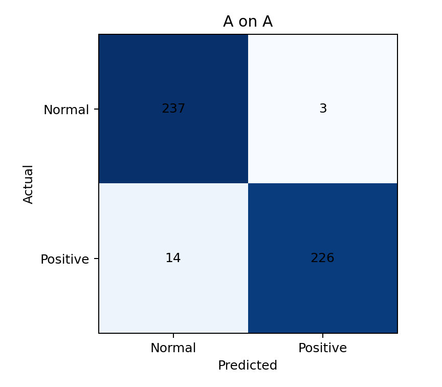
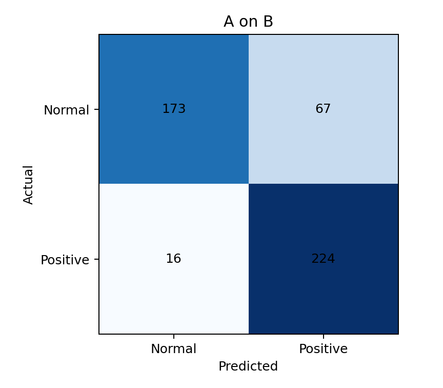
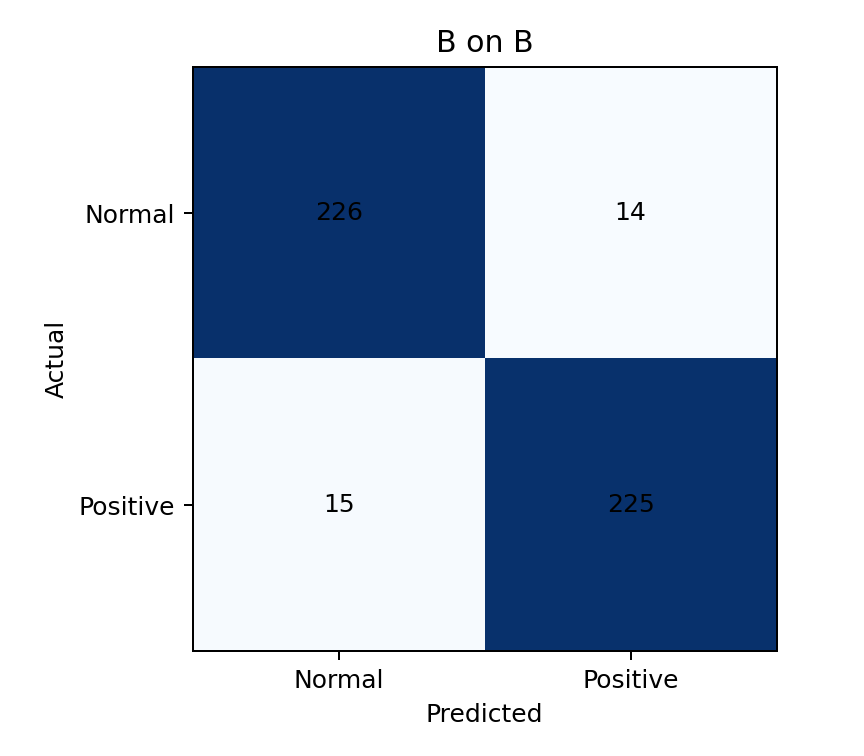
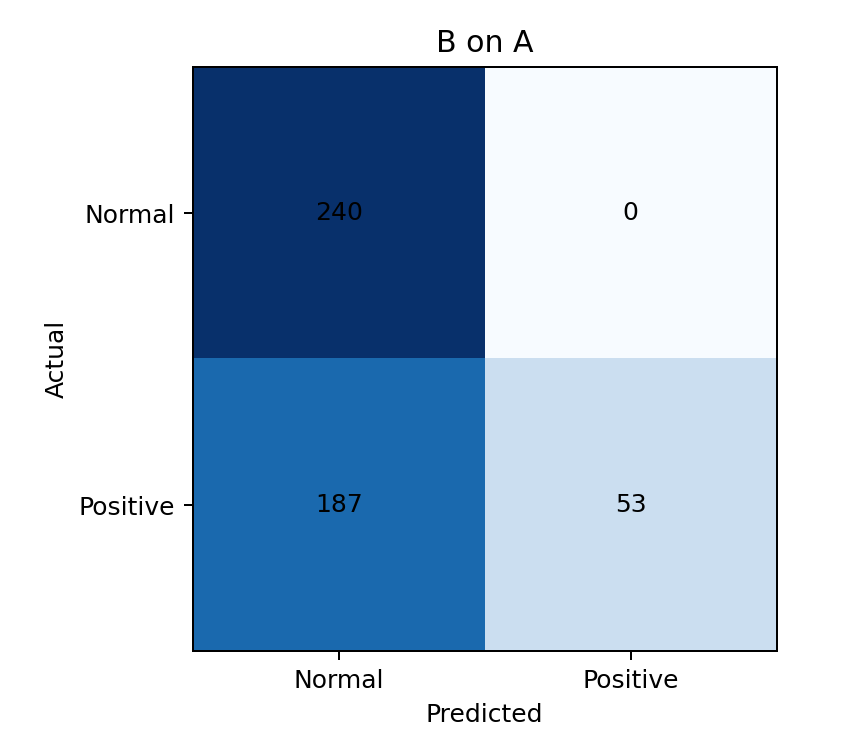

# Cross-Dataset Chest X-Ray Classification with MobileNetV2

**Nageshwar Yadav**  
M.Tech, Artificial Intelligence and Machine Learning

This repository is the saved FRIEND chest X-ray study. Two ImageNet-initialized MobileNetV2 models are trained separately, one on each public collection, and scored in four directions. PyTorch trains the networks. scikit-learn computes accuracy, macro-F1, the classification report, and the confusion matrix.

Every score below is the value stored in a metric file, rounded half-up to four decimal places.

| Evaluation | What it means | Test images | First-run accuracy | First-run macro-F1 | Selected-config accuracy | Selected-config macro-F1 |
|---|---|---:|---:|---:|---:|---:|
| A on A | Trained on A, tested on A | 480 | 0.9646 | 0.9646 | 0.9771 | 0.9771 |
| A on B | Trained on A, tested on B | 480 | 0.8271 | 0.8251 | 0.7313 | 0.7143 |
| B on B | Trained on B, tested on B | 480 | 0.9396 | 0.9396 | 0.9271 | 0.9271 |
| B on A | Trained on B, tested on A | 480 | 0.6104 | 0.5407 | 0.6708 | 0.6308 |

Source files: `results/metrics_*.json` and `optimization/results/optimized_metrics_*.json`.

The sharp failure is B tested on A. The first model calls 187 of 240 Positive images Normal, and it calls 0 of 240 Normal images Positive. Positive recall for that test is 0.2208.

Conference paper: [paper/cross_dataset_mobilenetv2.pdf](paper/cross_dataset_mobilenetv2.pdf)

## What the two datasets are

| | Dataset A | Dataset B |
|---|---|---|
| Source | Kermany chest X-ray release, Kaggle `chest-xray-pneumonia` | COVID-19 Radiography Database, Kaggle `covid19-radiography-database`, version 5 |
| Class 0 | Normal | Normal |
| Class 1 | Pneumonia | Lung Opacity |
| Domain label in the files | `A_Kermany` | `B_COVID_Radio` |
| Images used | 1,200 per class | 1,200 per class |

The COVID and Viral Pneumonia folders are not in the training or test lists. This is a Normal-versus-Pneumonia model against a Normal-versus-Lung-Opacity model.

Both classes are split 80/20 with seed 42. That gives 1,920 training images and 480 test images per dataset. Each test report has support 240 for Normal and 240 for Positive. The 480 test filenames match across the first run and the selected-configuration run.

The prediction tables have no patient or user column, so there is no user-wise table.

## How a number was produced

| Stage | Tool | What it wrote |
|---|---|---|
| Download the two collections | kagglehub | Image files only. It did not compute accuracy. |
| Open images | Pillow | RGB tensors for the network, and a 64×64 grayscale image for the duplicate hash |
| Cross-collection duplicate screen | Python hashlib (SHA-256) | `duplicate_check.json`: 0 files excluded, 0 corrupt files |
| Balanced split | Python `random`, seed 42 | `split_summary.json` |
| Resize, flip, rotation, normalize, batch | torchvision and PyTorch | 224×224 ImageNet-normalized batches. First-run batch size 16 |
| Train MobileNetV2 | torchvision weights, PyTorch AdamW, cross-entropy | Checkpoints and training loss in the history files |
| Class probabilities | PyTorch softmax | `p_normal`, `p_positive`, and uncertainty in the prediction CSVs |
| Accuracy, macro-F1, confusion matrix | scikit-learn | The metric JSON files and the counts in the figures |
| Selective prediction | Project function on the saved probabilities, written by pandas | `results/selective_prediction.csv` and `optimization/results/optimized_selective_prediction.csv` |
| Figures | matplotlib | Confusion matrices, example montages, and the optimized bar chart |

## Two training settings

**First run (the baseline named in `optimization/results/baseline_vs_optimized.csv`).**  
ImageNet MobileNetV2, learning rate 0.0001, weight decay 0.0001, five epochs, last four feature blocks unfrozen at epoch 3, batch size 16. The checkpoint is the epoch with the highest scikit-learn macro-F1 on the 480-image test split. That is the limit of this run: the test images choose the checkpoint, and the same images are then reported as the test score. For model A, the saved validation macro-F1 at epochs 3 and 4 is identical to the A-on-A test macro-F1. For model B, epoch 5 matches the B-on-B test macro-F1.

**Selected configuration.**  
A separate shuffle (`random.Random(42+99)`) holds out 192 validation images, leaving 1,728 training images. The 480 test images stay untouched. Four settings are trained for three epochs. The saved rule keeps the setting with the highest mean of the two validation macro-F1 values.

| ID | Learning rate | Weight decay | Dropout | Unfrozen blocks | Validation macro-F1 on A | Validation macro-F1 on B |
|---|---:|---:|---:|---:|---:|---:|
| c1 | 0.0001 | 0.0001 | 0.2 | 4 | 0.9531 | 0.8958 |
| c2 | 0.0003 | 0.0001 | 0.2 | 4 | 0.9531 | 0.9167 |
| c3 | 0.0001 | 0.001 | 0.3 | 6 | 0.9635 | 0.9323 |
| c4 | 0.00003 | 0.0001 | 0.3 | 6 | 0.9427 | 0.9063 |

c3 is the saved winner. Its mean validation macro-F1 is 0.9479. It is retrained for five epochs at batch size 32, with the last six blocks unfrozen at epoch 2. The test table above is that retrained pair.

The two columns are not a single-factor comparison. The checkpoint split, the training count (1,920 versus 1,728), the batch size (16 versus 32), dropout, weight decay, and the number of unfrozen blocks all change together.

## First-run confusion matrices

Rows are the actual label. Columns are the predicted label. These PNG files were drawn by matplotlib from the scikit-learn counts.

| A on A | A on B |
|---|---|
|  |  |

| B on B | B on A |
|---|---|
|  |  |

Selected-configuration counts, from the optimized metric JSON files:

| Evaluation | Normal predicted Normal | Normal predicted Positive | Positive predicted Normal | Positive predicted Positive |
|---|---:|---:|---:|---:|
| A on A | 238 | 2 | 9 | 231 |
| A on B | 117 | 123 | 6 | 234 |
| B on B | 220 | 20 | 15 | 225 |
| B on A | 240 | 0 | 158 | 82 |

On the selected A-on-B model, Normal recall is 0.4875 (117 of 240). That is why accuracy falls from 0.8271 to 0.7313 even though positive recall rises to 0.9750.

## Selective prediction

Run only on the two cross tests. Uncertainty is `1 - max(softmax probability)`. An image is answered when uncertainty is at most the threshold. pandas wrote the CSVs. scikit-learn did not compute these columns.

At threshold 0.5, coverage is 1 and selective accuracy matches the test accuracy in the table above.

| Model | Test | Threshold | Answered | Abstained | Coverage | Selective accuracy |
|---|---|---:|---:|---:|---:|---:|
| First | A on B | 0.3 | 410 | 70 | 0.8542 | 0.8488 |
| First | A on B | 0.4 | 436 | 44 | 0.9083 | 0.8463 |
| First | A on B | 0.5 | 480 | 0 | 1.0000 | 0.8271 |
| First | B on A | 0.3 | 422 | 58 | 0.8792 | 0.6445 |
| First | B on A | 0.4 | 464 | 16 | 0.9667 | 0.6121 |
| First | B on A | 0.5 | 480 | 0 | 1.0000 | 0.6104 |
| Selected | A on B | 0.3 | 428 | 52 | 0.8917 | 0.7547 |
| Selected | A on B | 0.4 | 456 | 24 | 0.9500 | 0.7412 |
| Selected | A on B | 0.5 | 480 | 0 | 1.0000 | 0.7313 |
| Selected | B on A | 0.3 | 398 | 82 | 0.8292 | 0.7010 |
| Selected | B on A | 0.4 | 437 | 43 | 0.9104 | 0.6865 |
| Selected | B on A | 0.5 | 480 | 0 | 1.0000 | 0.6708 |

Abstaining at 0.3 leaves B-on-A selective accuracy at 0.6445 for the first model and 0.7010 for the selected model.

## Recorded jobs

Both jobs name a Tesla T4. The notebook session printed PyTorch 2.14.1+cu130. No file stores per-image latency or throughput.

| Job | When | Batch | Minutes | What the minutes include |
|---|---|---:|---:|---|
| Pipeline resume and re-evaluation | 17 November 2026, 11:04:09 UTC | 16 | 3.6 | Both models resumed from epoch 6. The pass repeated the four evaluations, the selective-prediction table, and the figures. It is not a from-scratch training time. GPU memory on this record is 14.6 GB. |
| Optimization invocation | 17 November 2026, 11:11:52 UTC | 32 | 7.7 | The log skipped eight already saved search trials, then trained the two final models and scored them. The trial file does not store a duration for the earlier three-epoch search. |

The run log repeats the first-run accuracy and macro-F1 on 11 October 2026 (two passes), 12 November 2026, and 17 November 2026.

## Repository map

```text
FRIEND_Colab_Train.ipynb          Training, four evaluations, and the search
checkpoints/                      First-run MobileNetV2 checkpoints
results/                          First-run metrics, predictions, figures
optimization/                     Search trials, selected config, second test
optimization/checkpoints/         c3 checkpoints
optimization/results/             Selected-configuration metrics and predictions
paper/cross_dataset_mobilenetv2.pdf
split_summary.json                1920 / 480 split, seed 42
duplicate_check.json              0 excluded files, 0 corrupt files
run_log.csv                       Repeated evaluations of the first-run scores
progress.json                     3.6 minute pipeline record
```

Checkpoints are the trained weights. `model_*_best.pt` is about 20 MB each. `optimized_model_*_best.pt` is about 9 MB each.

## Reproduce

The notebook is written for Google Colab with a GPU. The pipeline raises an error if CUDA is not available. The recorded machine was a Tesla T4.

1. Open `FRIEND_Colab_Train.ipynb` in Colab.
2. Set **Runtime → Change runtime type → GPU**.
3. Run the cells from the top. Approve the Google Drive mount when Colab asks. Outputs go to `MyDrive/friend-cxr-30`.
4. The first code cell installs `kagglehub` and prints the PyTorch version and GPU name.
5. `run_pipeline()` downloads both Kaggle datasets, screens for cross-collection duplicates, trains the two models, and writes the four evaluations.
6. The last cell is the four-setting search. It reuses functions from the earlier cells, so those cells have to have been run in the same session. If the trial CSV already exists, that cell skips the saved trials and retrains the final models.

A finished checkpoint is resumed. On the 17 November 2026 log, both first-run models resumed from epoch 6, which means training had already finished and that invocation re-evaluated them.

Local packages used by the notebook: PyTorch, torchvision, scikit-learn, Pillow, pandas, NumPy, matplotlib, and kagglehub.

## Paper

[paper/cross_dataset_mobilenetv2.pdf](paper/cross_dataset_mobilenetv2.pdf) is the four-page conference write-up of these files. `paper/build_like_lodo.py` rebuilds that PDF from the same numbers. The PDF does not add a result that is absent from the JSON and CSV files.

## Limit

The first run selects its checkpoint on the 480 images that it then reports as the test set. The selected-configuration test does not do that. It uses a 192-image validation split and the same 480 test filenames. That second test is still one seed, one network, and one split.

## Citation

Nageshwar Yadav, "Measured Cross-Dataset Accuracy of MobileNetV2 on Two Chest X-Ray Collections," M.Tech, Artificial Intelligence and Machine Learning, 2026. Scores in this repository were computed by scikit-learn from the saved predictions.
